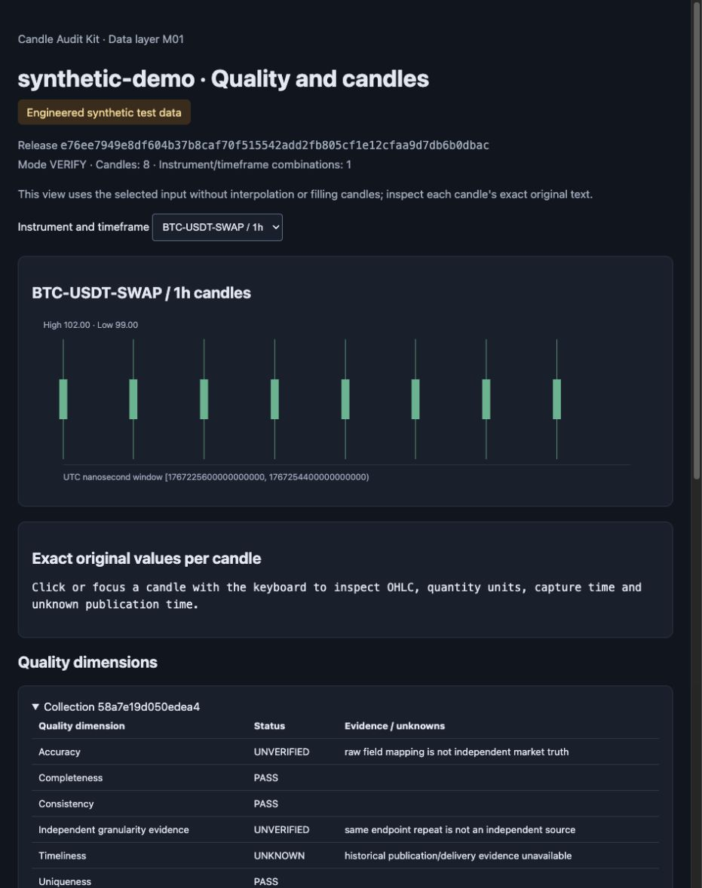

# Candle Audit Kit

Audit OKX candle files offline: find gaps and duplicates, reconcile CSV with native JSON, and preserve exact decimal values in reproducible datasets.

For quantitative researchers and Python data engineers checking local OHLCV inputs before research or backtesting.

[繁體中文](README.zh-TW.md) · [0.1.0rc2 candidate](https://github.com/linqingzi/candle-audit-kit/releases/tag/0.1.0rc2) · [MIT](LICENSE) · [CI](https://github.com/linqingzi/candle-audit-kit/actions/workflows/ci.yml)

**Read first — no installation:** [Open the English sample report](https://linqingzi.github.io/candle-audit-kit/examples/synthetic-report.en.html) · [閱讀中文報告](https://linqingzi.github.io/candle-audit-kit/examples/synthetic-report.html) · [Preview and local trial guide](https://linqingzi.github.io/candle-audit-kit/).

The public preview displays a fixed synthetic example and has no file upload. Local commands run the actual checks on your machine.



**A real run, using invented data.** Eight hourly candles become two complete 4-hour bars. The report keeps `UNVERIFIED` and `UNKNOWN` visible; a successful consistency check does not certify a market source. [Download the full English offline HTML report](docs/examples/synthetic-report.en.html) and open it locally. [Image provenance](docs/images/PROVENANCE.md).

## Quick start

To run locally, download the [0.1.0rc2 source ZIP](https://github.com/linqingzi/candle-audit-kit/releases/download/0.1.0rc2/candle-audit-kit-0.1.0rc2.zip) and extract it. No Git client is needed. Requires CPython 3.11–3.14 on macOS or Linux; use your installed supported Python executable in the venv command below. First installation downloads packages from official PyPI; the demo itself needs no network, account or API key. This is a release candidate, not a stable release.

```sh
cd candle-audit-kit-0.1.0rc2
python3.11 -m venv .venv
. .venv/bin/activate
python -m pip install --index-url https://pypi.org/simple .
candle-audit demo --root data/demo --language en
```

Key output fields (the CLI also prints dataset IDs and report paths):

```json
{
  "status": "SYNTHETIC_DEMO_COMPLETE",
  "rows": 8,
  "aggregate_rows": 2,
  "network_used": false,
  "source_verification": "UNVERIFIED",
  "admission": "NOT_EVALUATED"
}
```

Open the file printed as `report.html_path`, under `data/demo/reports/`. It is self-contained HTML. **The 0.1.0rc2 candidate includes `--language en`; the older 0.1.0rc1 archive predates this option.** Omit the option for the original Chinese view. The JSON evidence retains its original schema and text in either language. The complete CSV, original-response JSON, metadata, source, request and page inputs are in `data/demo/inputs/`; source fixtures are in [examples/synthetic](examples/synthetic). Changed demo inputs are never silently overwritten. Install time depends on your connection and available native wheels.

For development, clone the repository instead and run the same setup commands from its root. Candidate archive hashes are listed in the release's `SHA256SUMS.txt`.

## What you can check

| Need | What the tool provides |
| --- | --- |
| Compare an export with its original response | Field-by-field CSV/native-JSON reconciliation, preserving original decimal strings |
| Find inconsistent candle inputs | Identity, gaps, duplicates, time windows, closed-bar and quantity-unit checks |
| Keep a reproducible local dataset | Immutable snapshots and Parquet releases, revisions and source hashes |
| Inspect a selected time window | Bounded DuckDB queries and aggregation of complete UTC buckets |
| Review what remains unknown | English or Chinese HTML views and unchanged JSON evidence with explicit `UNVERIFIED` and `UNKNOWN` states |

## Scope and limits

Supports OKX SPOT and linear USDT SWAP **trade candles**. Other venues, mark/index candles and inverse contracts are rejected. This is a pre-release. It does not place orders or use trading accounts. The synthetic demo is not live market data, and matching supplied files does not prove exchange origin or profitability.

The workspace is your current directory, independent of package installation. Inputs and outputs are restricted to `data/` and `.tmp-data-layer/`. Alternatively set `CANDLE_AUDIT_WORKSPACE` to an existing absolute directory without symlinks. Reads preserve dataset versions but need writable temporary verification space. Native dependencies may impose additional minimum OS requirements; Windows support and market-scale performance are not claimed.

## Commands and documentation

```sh
candle-audit providers
candle-audit ingest --help
candle-audit collect --help
candle-audit read --help
candle-audit report --help
python -m candle_audit.data_layer --help
```

- [Candidate ingestion](docs/data_layer_m1.md): complete CSV/JSON import parameters.
- [Dataset interface](docs/data_layer_full.md): collections, releases, reads, aggregation and reports.
- [Validation evidence](docs/validation.md) and [limitations](docs/limitations.md): actual checks and their boundaries.
- [Feedback and small first contributions](docs/contributing.md): reproducible issues, documentation and platform validation.

## Reproduce tests and packaging

From the source root, with the isolated environment activated:

```sh
python -m pip install --index-url https://pypi.org/simple -r requirements-test-lock.txt
python -m pip install --no-build-isolation --no-deps .
python -m pip check
python -B -m pytest -q
python -m build --no-isolation
```

The lock includes test/build tools in addition to the six pinned runtime dependencies. Tests use synthetic fixtures and block socket connections. The full suite retains 1000-example property settings and takes substantial time. For a fast development check only, use `python -B -m pytest -q -m 'not property'`.

The initial public CI completed with **662 passed, 0 failed and 3 skipped**. The three skips require missing pre-standalone historical artifacts; they establish no backward-compatibility guarantee. Three current-format relocation controls are tested separately. See the [actual run](https://github.com/linqingzi/candle-audit-kit/actions/runs/39603372781) and [current CI](https://github.com/linqingzi/candle-audit-kit/actions/workflows/ci.yml) for the precise environments and latest results. Other OS/Python combinations are not implied to have passed.

## License, provenance and support

Project material is licensed under [MIT](LICENSE). The maintainer confirmed that the inherited project code, tests and examples were developed under their direction with Codex and authorized MIT publication. This does not relicense third-party dependencies. Their original terms and copyright texts remain in [third-party notices](THIRD_PARTY_NOTICES.md) and [licenses/third-party](licenses/third-party).

See [source provenance](PROVENANCE.md), [license status](LICENSE-STATUS.md), [release status](RELEASE_STATUS.md) and [the changelog](CHANGELOG.md). No claim of established adoption, external certification, production readiness, OpenAI endorsement or grant selection is made.
