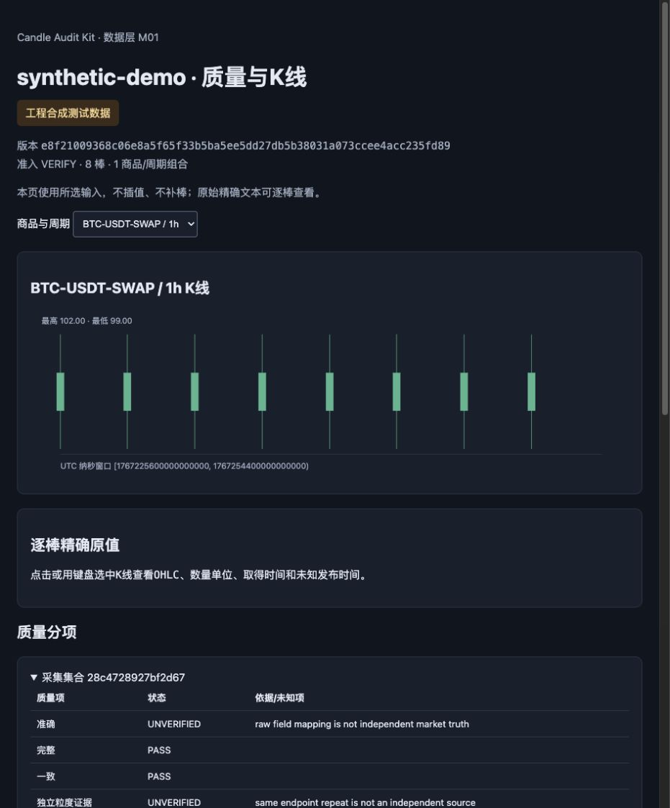

# Candle Audit Kit：離線 K 線核對工具

離線核對 OKX K 線 CSV 與原生 JSON，找出缺漏、重複及單位問題，保留精確小數與可重現的資料版本。

適合自行整理 OHLCV 資料的量化研究者與 Python 資料工程師，在研究或回測前先檢查輸入資料。

[English](README.md) · [0.1.0rc2 候選版](https://github.com/linqingzi/candle-audit-kit/releases/tag/0.1.0rc2) · [MIT](LICENSE) · [CI](https://github.com/linqingzi/candle-audit-kit/actions/workflows/ci.yml)

**先看報告，無需安裝：** [直接閱讀中文合成報告](https://linqingzi.github.io/candle-audit-kit/examples/synthetic-report.html) · [English report](https://linqingzi.github.io/candle-audit-kit/examples/synthetic-report.en.html) · [預覽與本機試用入口](https://linqingzi.github.io/candle-audit-kit/)。

公開預覽只展示固定的合成範例，沒有檔案上傳功能。實際稽核需在本機執行程式。



**這是實際執行結果，資料全部為人工合成。** 八根小時 K 線會聚合成兩根完整四小時 K 線。報告保留 `UNVERIFIED` 與 `UNKNOWN`；核對一致不代表已證明真實市場來源。[下載完整離線 HTML 報告](docs/examples/synthetic-report.html)後在本機開啟。截圖來源見[影像紀錄](docs/images/PROVENANCE.md)。

## 快速上手

要在本機執行，先下載 [0.1.0rc2 原始碼 ZIP](https://github.com/linqingzi/candle-audit-kit/releases/download/0.1.0rc2/candle-audit-kit-0.1.0rc2.zip) 並解壓縮，不需要 Git。需有 CPython 3.11–3.14 與 macOS 或 Linux；下方建立環境時請使用已安裝的支援版本。首次安裝會從官方 PyPI 下載套件；合成範例本身不需網路、帳戶或 API 密鑰。目前仍為候選版，並非穩定版。

```sh
cd candle-audit-kit-0.1.0rc2
python3.11 -m venv .venv
. .venv/bin/activate
python -m pip install --index-url https://pypi.org/simple .
candle-audit demo --root data/demo
```

預期的重要欄位如下；實際 CLI 也會列出資料版本 ID 與報告路徑：

```json
{
  "status": "SYNTHETIC_DEMO_COMPLETE",
  "rows": 8,
  "aggregate_rows": 2,
  "network_used": false,
  "source_verification": "UNVERIFIED",
  "admission": "NOT_EVALUATED"
}
```

開啟 `report.html_path` 指向的檔案，位置在 `data/demo/reports/`。HTML 報告可獨立離線查看。完整 CSV、原始 JSON、metadata、source、request 及 pages 輸入位於 `data/demo/inputs/`，原始合成樣例也在 [examples/synthetic](examples/synthetic)。你改過的範例輸入不會被默默覆寫。安裝時間視網路與原生套件是否可取得而定。

`0.1.0rc2` 候選版已包含可選的 `--language en` 英文 HTML 展示，`demo` 與 `report` 均可使用；省略時保留原中文預設。JSON 證據的格式與文字不隨展示語言變更。既有 `0.1.0rc1` 壓縮包早於此功能，未變更。中文版首頁保留原中文報告圖；英文版使用真實生成的英文圖。

開發者也可複製 Git 倉庫，再從根目錄執行相同安裝步驟。下載檔的 SHA256 記錄列在發布頁的 `SHA256SUMS.txt`。

## 能檢查什麼

| 需求 | 提供的功能 |
| --- | --- |
| 核對匯出檔與原始回應 | CSV／原生 JSON 逐欄對照，保留原始小數文字 |
| 發現 K 線輸入問題 | 身分、缺漏、重複、時間範圍、收棒狀態與數量單位檢查 |
| 保存可重現的本地資料 | 不可變快照、Parquet 版本、修訂紀錄與來源雜湊 |
| 查看指定時間窗口 | 有界限的 DuckDB 查詢、完整 UTC 時桶聚合 |
| 理解證據缺口 | 中文或英文 HTML 展示、原格式 JSON 證據，明示 `UNVERIFIED`、`UNKNOWN` |

## 範圍與限制

支援 OKX 現貨與線性 USDT 永續合約的**成交 K 線**。其他交易所、標記／指數 K 線、反向合約會被拒絕。目前是預發布版本，不下單或使用交易帳戶。範例不是真實即時行情；檔案核對一致不證明交易所來源，也不代表盈利能力。

預設工作區是目前資料夾，不依賴程式安裝位置。所有輸入／輸出限於 `data/` 或 `.tmp-data-layer/`。也可用 `CANDLE_AUDIT_WORKSPACE` 指定已存在且無符號連結的絕對目錄。讀取保留既有資料版本，但需要可寫的暫存核對空間。原生套件可能有額外最低作業系統要求；不宣稱 Windows 支援或市場規模效能已驗證。

## 命令與文件

```sh
candle-audit providers
candle-audit ingest --help
candle-audit collect --help
candle-audit read --help
candle-audit report --help
python -m candle_audit.data_layer --help
```

- [候選資料匯入](docs/data_layer_m1.md)：完整 CSV／JSON 匯入參數。
- [資料層介面](docs/data_layer_full.md)：採集集合、版本、讀取、聚合與報告。
- [驗證紀錄](docs/validation.md)及[限制](docs/limitations.md)：實際證據與適用範圍。
- [回報問題與初次貢獻](docs/contributing.md)：可重現問題、文件與平台驗證。

## 重現測試與打包

回到原始碼根目錄，啟用隔離環境後執行：

```sh
python -m pip install --index-url https://pypi.org/simple -r requirements-test-lock.txt
python -m pip install --no-build-isolation --no-deps .
python -m pip check
python -B -m pytest -q
python -m build --no-isolation
```

鎖定檔除了六個固定版本的執行依賴，也包含測試／打包工具。測試使用合成資料並阻擋網路連線。完整性質測試保留每項 1000 例設定，可能耗時；開發時可用 `python -B -m pytest -q -m 'not property'` 快速檢查，但不能當成全套驗收。

首次公開 CI 實際完成 **662 通過、0 失敗、3 跳過**。三個跳過案例缺少獨立化前的歷史產物，不能作為舊格式相容保證；另有三項目前格式的真實搬移測試。請看[該次結果](https://github.com/linqingzi/candle-audit-kit/actions/runs/39603372781)、[最新 CI](https://github.com/linqingzi/candle-audit-kit/actions/workflows/ci.yml)及[驗證紀錄](docs/validation.md)，不要推定所有平台或 Python 組合都已通過。

## 授權、來源與支援狀態

自有程式依 [MIT](LICENSE) 授權。使用者已確認原程式、測試及樣例由其指揮 Codex 開發，並同意公開；以「Candle Audit Kit contributors」署名，不加入未確認的個人真名或郵件。這項確認不會改授權第三方依賴；[第三方聲明](THIRD_PARTY_NOTICES.md)及 [licenses/third-party](licenses/third-party) 保留各原始條款與著作權。

來源可核實事項見 [PROVENANCE.md](PROVENANCE.md)，確認紀錄見 [LICENSE-STATUS.md](LICENSE-STATUS.md)，版本狀態見 [RELEASE_STATUS.md](RELEASE_STATUS.md) 與[變更紀錄](CHANGELOG.md)。不宣稱已有廣泛採用、外部認證、正式系統適用性、OpenAI 背書或活動獲批。
